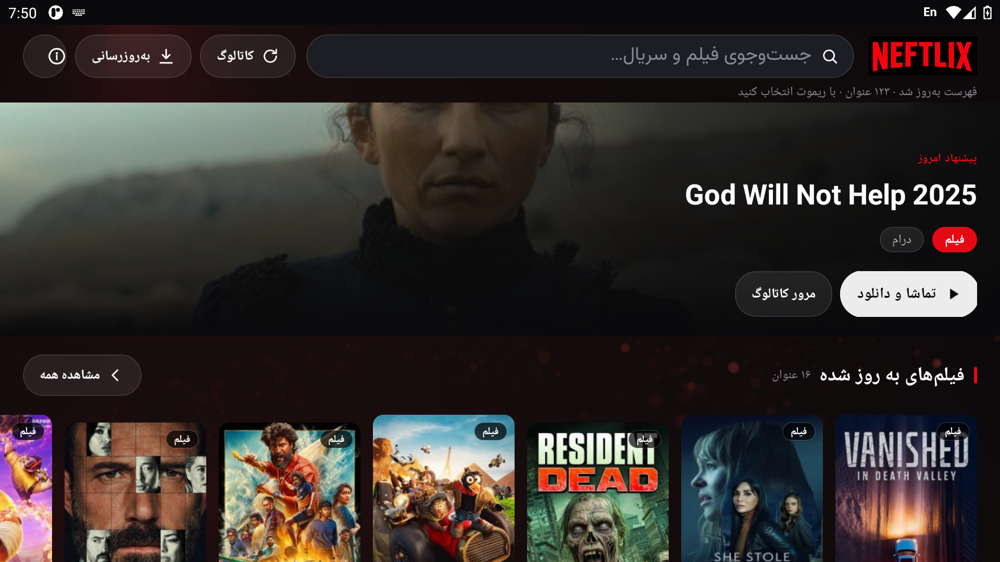

 <p align="center">
  
</p>

<h1 align="center">Neftlix</h1>

<p align="center">
  <strong>A Persian-language Android TV app for movies and series.</strong>
</p>

<p align="center">
  
</p>

Neftlix is a native Android TV application for browsing the movie and series catalog on [فیلم۲مدیا](https://myf2mi.top). It features archive-wide search, expandable watch lists, an integrated ExoPlayer-based video player with Persian subtitle support, and automatic in-app update notifications.

The app communicates directly with the media source, requiring no dedicated backend server.

## Features

### Browsing and discovery

- **Home screen:** Horizontal rails for each catalog section, with 20-item previews and links to view the full collection. Genre chips provide quick access to movies and series.
- **Archive-wide search:** Uses the site's `quick-search` endpoint, with fallbacks to page search and the locally cached catalog. Supports English voice search and automatic focus on the first result.
- **Content details:** Displays wide key art, posters, cleaned titles, IMDb ratings, satisfaction scores, content type, and available links.
- **YouTube trailers:** Opens the YouTube app with a search query based on the title and release year.
- **Expandable watch lists:** Browse seasons, dubbing and subtitle categories, video quality options, and episode links. Comments and the watch list are independently expandable sections.

### Video playback

- **Integrated player:** Streams available media links through AndroidX Media3 ExoPlayer.
- **Persian subtitles:** Automatically prefers Persian subtitles, with Vazirmatn typography, right-to-left text, transparent backgrounds, and drop shadows.
- **Remote controls:** D-pad navigation, OK to select or expand, and Back to navigate or control playback.
- **Playback shortcuts:** Seek backward or forward by 15 seconds while player controls are hidden.
- **Screen stays awake:** Prevents the TV box from activating its screensaver during playback.

### Android TV interface

- **Consistent scaling:** A shared 960dp design system (`Ui.java`) scales dimensions, spacing, and typography using `screenWidthDp / 960`, maintaining consistent proportions across 720p, 1080p, and 4K displays.
- **Stable focus states:** Focused elements use a red outline and bold titles without resizing, preventing layout overflow.
- **Custom theme:** Netflix-inspired black-and-red styling, translucent panels, glass-like pills, and a full-screen transparent-logo splash screen.
- **Persian typography:** Vazirmatn throughout the application and subtitle rendering.
- **App information:** An information card with the app description, version, author, media source attribution, website link, and a QR code linking to `arazgray.com`.

### Caching and updates

- **Fast startup:** The most recently loaded catalog is displayed immediately from the on-device cache.
- **Background refresh:** The catalog refreshes quietly on each fresh launch. The catalog refresh action forces a full refresh with a centered loading indicator.
- **Automatic update checks:** Checks `version.json` on launch and displays an update dialog when a newer version is available.
- **Manual updates:** Downloads the new APK with progress reporting and cancellation, cleans up the temporary file, and opens the Android package installer.

## Requirements

- Xiaomi Mi Box 4K or another compatible Android TV device.
- Android 5.0 (API 21) or later.
- Internet access to `myf2mi.top` for catalog and media content.
- Internet access to `github.com` for releases and updates.

## Installation

1. Download `neftlix-android-tv.apk` from the [latest GitHub release](../../releases/latest), or download the `neftlix-tv-apk` artifact from a successful **Build Neftlix TV APK** workflow run.
2. Transfer the APK to your Android TV device using a USB drive, ADB, or a file-manager application.
3. Install the APK and launch **Neftlix**.

On Android 8 and later, you may need to enable **Install unknown apps** for the application used to install the APK.

> **One-time reinstall required for v1.3+:** Releases through v1.2 were signed with temporary CI keys. Android cannot update those installations using the persistent signing key introduced in v1.3. Uninstall the older version and install v1.3 or later. Subsequent releases can be installed normally as long as the signing key remains unchanged.

## Development

### Continuous integration

GitHub Actions builds and tests the application without requiring a locally installed Android SDK.

- **`android-tv-apk.yml`**: Runs `testDebugUnitTest` and uploads the debug APK artifact on pushes affecting `app/`.
- **`release-apk.yml`**: Builds a signed APK and publishes a GitHub Release when a `v*` tag is pushed.

### Publishing a release

1. Update `versionCode` and `versionName` in `app/build.gradle`.
2. Commit your changes and create a version tag:

   ```bash
   git tag vX.Y
   git push origin vX.Y
   ```

3. Wait for the release workflow to build and publish the signed APK.
4. Update `version.json` with the new `versionCode`, `versionName`, `apkUrl`, and `notes`, then commit and push the changes.
5. The application will offer the update on its next launch or when the user checks manually.

### Release signing

Release builds use a persistent PKCS#12 keystore stored in GitHub Actions secrets prefixed with `NEFTLIX_KEYSTORE_`. CI restores the keystore before building. The keystore itself is never committed to the repository.

Local builds without the release keystore fall back to the default debug signing configuration. If the release key is replaced, users must uninstall the existing app before installing a build signed with the new key.

### Visual testing

Screenshots are committed as static files (`screenshot.png` and `screenshot-details.png`). Emulator-based CI is intentionally omitted because booting an Android TV emulator on GitHub-hosted runners adds substantial build time. Visual verification is performed using the screenshots and a regular device installation.

## Tests

JVM unit tests are located in `app/src/test/` and use JUnit 4. They run in CI on pushes affecting `app/`.

| Test suite | Coverage |
|---|---|
| `UiTest` | Persian digits, content-type labels, high-resolution image URLs, 960dp scale clamping, and grid calculations |
| `DisplayTextTest` | Title cleanup, watch-label rewriting, and YouTube trailer queries |
| `CatalogRepositoryTest` | Pagination, search responses, content-type and URL validation, article cards, genre extraction, and download-link parsing |
| `CatalogCacheTest` | Cache save/load round trips, missing files, and corrupted data |

Android-dependent components, including views, Glide, and ExoPlayer, are kept outside the tested surface where practical. Pure logic is extracted into static or package-private helpers.

## Project structure

```text
.
├── app/
│   └── src/
│       ├── main/java/com/arazgray/neftlix/
│       │   ├── Ui.java
│       │   └── DisplayText.java
│       └── test/
├── android-tv-apk.yml
├── release-apk.yml
├── version.json
├── icon.png
├── logo.png
├── logo_transparent.png
├── main-bg.png
├── screenshot.png
├── screenshot-details.png
└── tv-preview.html
```

| File | Purpose |
|---|---|
| `Ui.java` | Design system, colors, scaling, spacing, typography, and reusable TV components |
| `DisplayText.java` | Title cleanup, watch-label formatting, and trailer queries |
| `app/src/test/` | JVM unit tests |
| `version.json` | Version metadata consumed by the in-app updater |
| `icon.png`, `logo.png`, `main-bg.png` | Launcher, banner, and branding assets |
| `logo_transparent.png` | Transparent logo used within the application |
| `tv-preview.html` | Static preview of the application screens |

## Technology stack

- **Language:** Java
- **Platform:** Native Android TV
- **Playback:** AndroidX Media3 ExoPlayer
- **HTML parsing:** JSoup
- **Image loading:** Glide
- **Testing:** JUnit 4
- **CI/CD:** GitHub Actions

## Media source and attribution

Catalog information and media links are sourced from [فیلم۲مدیا](https://myf2mi.top). Neftlix retrieves content directly from the website and does not require a dedicated backend server.

Neftlix is an independently developed application. The media catalog and linked content belong to their respective providers.
